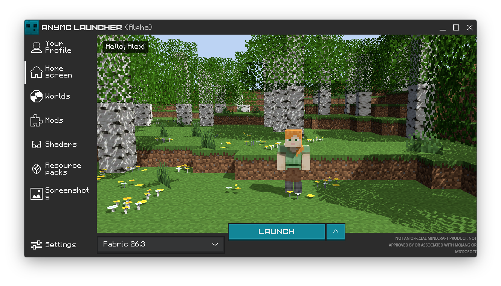

# AnyMC Launcher

[](LICENSE)

AnyMC is a modern, feature-rich, and open-source Minecraft launcher built with **Compose Multiplatform** and **Kotlin Multiplatform**. It aims to provide a fast, customizable, and user-friendly experience for managing Minecraft installations, mods, and accounts.



## Features

- **Multi-Version Support**: Easily install and launch any version of Minecraft.
- **Modding Integration**:
  - Native **Modrinth** integration for browsing and installing mods and modpacks.
  - Built-in support for **Fabric** and **Forge**.
- **Account Management**: Support for multiple accounts.
- **Customization**:
  - Minecraft-inspired UI theme.
- And more.

## Project Structure

The project is organized into several modules:

- **`:anymc-core`**: Core logic, hooks registry, and utility functions.
- **`:anymc-minecraft-core`**: Minecraft-specific logic including installation steps, launch logic, and metadata services (Modrinth, Fabric, MultiMC).
- **`:shared`**: The main Compose Multiplatform UI, view models, managers, and shared business logic.
- **`:desktopApp`**: The entry point for the desktop application (JVM).
- **`:anymc-servers`**: Future project for running AnyMC on a server to host them.

## Getting Started

### Prerequisites

- **JDK 21** or higher.
- **Gradle** (included via wrapper).

### Recommended editor
- Android Studio (with Compose Multiplatform plugin)

### Running the Desktop App

To run the application locally, use the following Gradle command:

```bash
./gradlew :desktopApp:run
```

### Building the Project

To build the launcher ready for distribution:

```bash
./gradlew :desktopApp:createDistributable --no-configuration-cache
```
The app files will be located in `desktopApp/build/compose/binaries/main/app/AnyMC Launcher`

To package the desktop app into a `.zip` (or `.tar.gz` on Linux) archive ready to install via the installer:

```bash
./gradlew :desktopApp:packageDesktopArchive --no-configuration-cache
```
The archive will be located in `build/dist` (other files in this directory are not required)

To build the installer:

```bash
./gradlew :installerApp:nativeCompile --no-configuration-cache
```
The installer can be found there `installerApp/native/nativeCompile/AnyMC-Installer` (other files in this directory are not required)

\* *On Windows, use `.\gradlew.bat` instead of `./gradlew`*

## Technologies Used

- **Language**: [Kotlin](https://kotlinlang.org/)
- **UI Framework**: [Compose Multiplatform](https://www.jetbrains.com/lp/compose-multiplatform/)
- **Networking**: [Ktor](https://ktor.io/)
- **Serialization**: [Kotlinx Serialization](https://github.com/Kotlin/kotlinx.serialization)
- **Concurrency**: [Kotlin Coroutines](https://kotlinlang.org/docs/coroutines-overview.html)
- **Graphics/Input**: [LWJGL](https://www.lwjgl.org/)

## Contributing

Contributions are welcome! If you'd like to improve AnyMC, please feel free to:
1. Fork the repository.
2. Create a feature branch.
3. Submit a Pull Request.

## AI Policy
Contributions with help of AI are allowed as long as you fully understand the code, and you reviewed it before creating your PR.

## License

This project is licensed under the [GNU General Public License v3.0](LICENSE) - see the [LICENSE](LICENSE) file for details.
